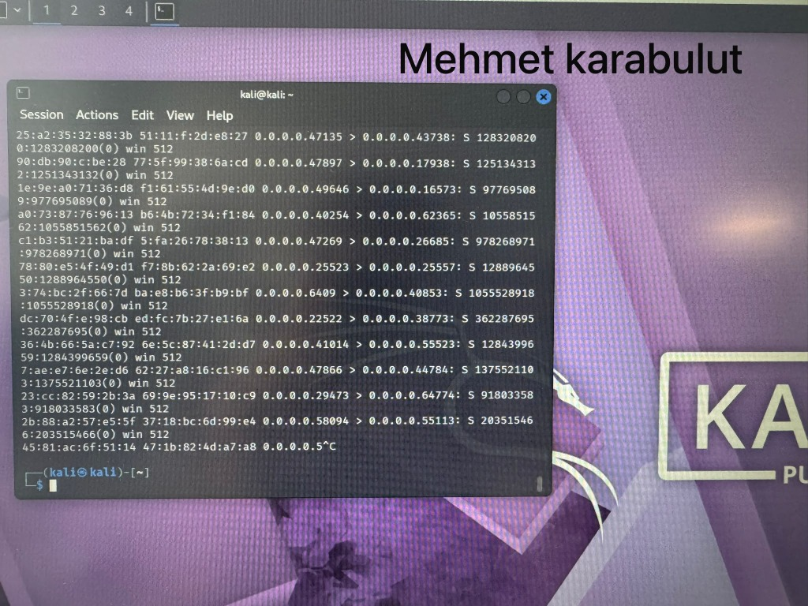

# Week 3 - Network Traffic & Packet Analysis

## Overview
Kali Linux lab session covering network packet analysis and terminal operations.

## Lab Screenshots

### Terminal Output

## Notes & Observations
- Packet capture / terminal session demonstrating network analysis on Kali Linux.
- Executed by: **Mehmet Karabulut**
